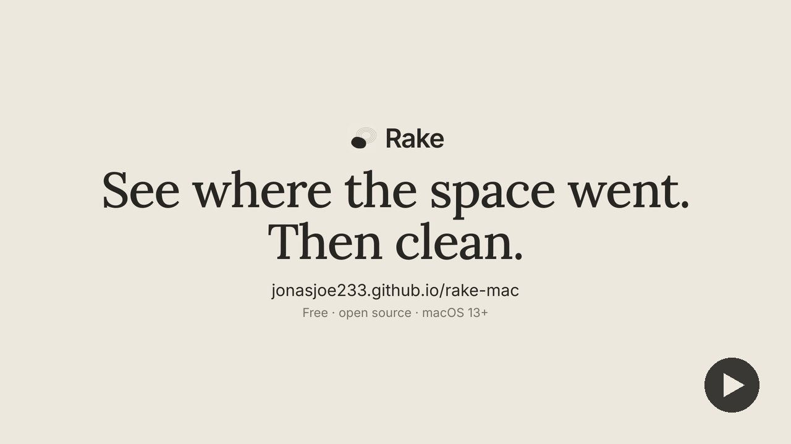

# Rake

See where the space went. Then clean.

[](https://jonasjoe233.github.io/rake-mac/#video)

<sub>Music: "Werq" Kevin MacLeod (incompetech.com) · [CC BY 4.0](http://creativecommons.org/licenses/by/4.0/)</sub>

Rake draws your disk as one map, tells you which parts are safe to clean, and shows the exact list before anything is touched.

## Download

[Rake.dmg](https://github.com/JonasJoe233/rake-mac/releases/latest/download/Rake.dmg) · macOS 13+ · Apple silicon and Intel

Or install from Terminal:

```sh
curl -fsSL https://raw.githubusercontent.com/JonasJoe233/rake-mac/main/install.sh | bash
```

## How it works

- **See it.** Rake draws your whole disk as one map.
- **Tick what's safe.** You tick what to clean. Caches are safe; old downloads are "check first".
- **Check it.** The exact list. Nothing else is touched.

Caches go. Everything else waits in the Trash.

## Opening Rake the first time

Rake isn't signed with a paid Apple developer certificate, so macOS asks before opening it the first time.

- On macOS 15 and later: open Rake once, close the warning, then go to System Settings → Privacy & Security and click Open Anyway.
- On macOS 13 and 14: right-click Rake in Applications and choose Open.

The Terminal command downloads Rake.dmg from GitHub Releases, copies Rake into /Applications and ejects the disk image. Files downloaded by curl don't carry the quarantine flag, so macOS doesn't show the warning. It never asks for your password.

When Rake first reads Desktop, Documents or Downloads, macOS asks for access. If you say no, those folders are skipped and counted as unclassified.

## Build from source

Needs macOS 13+ and the Swift toolchain from Xcode or the Command Line Tools.

```sh
scripts/build.sh   # builds build/Rake.app (arm64 + x86_64)
scripts/test.sh    # runs the tests
```

## Credits

MIT License. See [LICENSE](LICENSE) and [NOTICE](NOTICE).

Music in the video:

"Werq" Kevin MacLeod (incompetech.com)  
Licensed under Creative Commons: By Attribution 4.0 License  
http://creativecommons.org/licenses/by/4.0/
